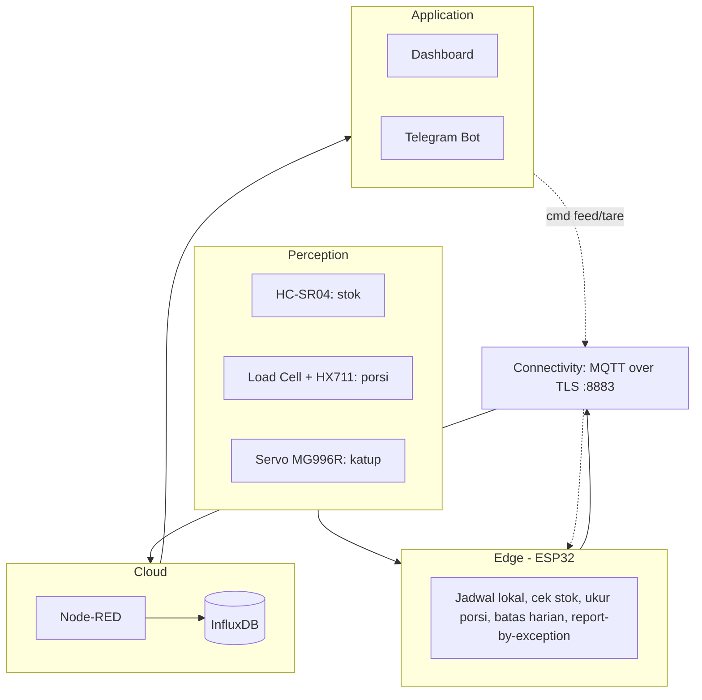

# Arsitektur Smart Pet Feeder

> Catatan konsistensi: Dokumen Perancangan memakai **Node-RED + InfluxDB**, sedangkan diagram arsitektur
> sebelumnya menulis ThingsBoard/MongoDB. Putuskan satu stack lalu samakan diagramnya.

## Topik MQTT
| Topik | Arah | Isi |
|---|---|---|
| `petfeeder/<id>/telemetry` | device -> cloud | stock_pct, bowl_g, distance_cm, daily_g, rssi, samples, sent |
| `petfeeder/<id>/event` | device -> cloud | feed (OK/FAILED/REJECTED), low_stock |
| `petfeeder/<id>/status` | device -> cloud | online/offline (LWT, retained) |
| `petfeeder/<id>/cmd` | cloud -> device | `{"action":"feed","grams":30}` / `{"action":"tare"}` |

## Keputusan edge
| Keputusan | Kenapa di edge | Jalan saat offline? |
|---|---|---|
| Jadwal makan | hewan tetap diberi makan walau internet mati | Ya (NTP sekali, lalu RTC) |
| Hentikan servo saat porsi tercapai / timeout | respons cepat, aman | Ya |
| Batas harian + jeda minimum | cegah overfeeding | Ya |
| Low stock (histeresis) | tidak spam notifikasi | Ya (event dibuffer) |
| Report-by-exception | hemat pesan | Ya |

## Perbandingan pesan sebelum/sesudah edge (isi saat uji)
| Skenario | Sampel sensor | Pesan terkirim | Penghematan |
|---|---|---|---|
| Tanpa edge (kirim tiap sampel) | _isi_ | _isi_ | - |
| Dengan edge | _isi_ | _isi_ | _isi_ % |

(Ambil dari field `samples` dan `sent` pada telemetry.)

## Analisis ancaman (draf)
| Ancaman | Dampak | Mitigasi |
|---|---|---|
| Perintah feed palsu | Overfeeding | TLS, user/pass unik per perangkat, ACL topik cmd, MAX_DAILY_GRAMS |
| Sadap lalu lintas | Data jadwal/kebiasaan bocor | MQTT over TLS 8883 + verifikasi CA |
| Kredensial bocor di repo | Perangkat diambil alih | `secrets.h` di .gitignore, hanya `secrets.h.example` yang di-commit |
| Telemetri dipalsukan | Notifikasi/analisis menyesatkan | Kredensial per perangkat, ACL topik telemetry |
| Katup macet | Hewan tidak makan | Deteksi FAILED + notifikasi Telegram |
